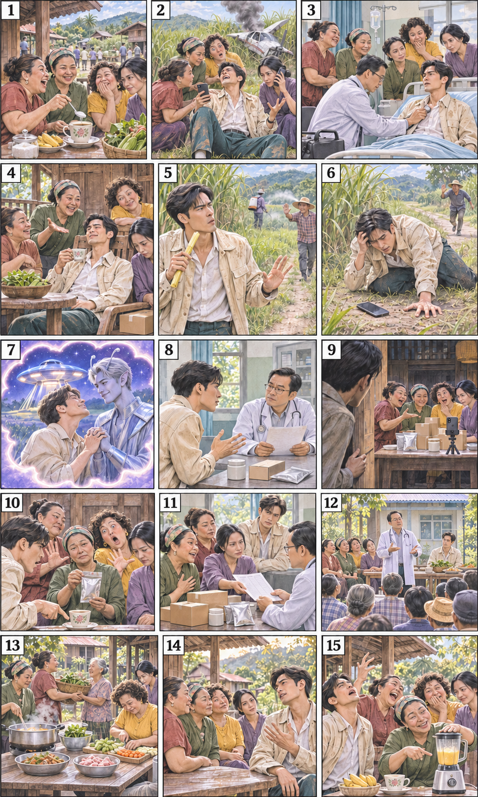

# คอปเต้อ — Storyboard ฉบับแก้ v2

16 พฤศจิกายน 2026 — ใช้คู่กับ [บทละครฉบับซ้อม v1](koptor-rehearsal-script-v1.md)



อ่านจากซ้ายไปขวา ทีละแถว ภาพนี้ปรับจาก storyboard เดิมโดยคงตัวละครและโทนภาพ เพิ่มจังหวะรักษาหลังอุบัติเหตุ เปลี่ยนปมกลุ่มลับเป็นการขายผลิตภัณฑ์ที่ปิดบังที่มา และเพิ่มการเปิดเผยข้อมูลกับการรับผิดชอบ ก่อนเข้าสู่บทหมอและมุกจบ

| ช่อง | เหตุการณ์ในภาพ | เชื่อมกับบทฉบับซ้อม |
|---|---|---|
| 1 | วงกาแฟ เรื่องความหวานและอาหารในชุมชน | ฉาก 1 |
| 2 | เครื่องบินตก สี่สาวพบคอปเต้อและประสานคนช่วย | ฉาก 2 |
| 3 | รับการรักษาในโรงพยาบาลก่อนกลับมาพักบ้านสี่สาว | รอยต่อท้ายฉาก 2 |
| 4 | พักฟื้น ถ้วยผลิตภัณฑ์ไม่ทราบส่วนประกอบ และกล่องที่ถูกเก็บไว้ | ฉาก 3 |
| 5 | สำรวจไร่อ้อย มุกน้ำหอม และเสียงเตือนให้ถอยออก | ฉาก 4 |
| 6 | อาการผิดปกติและคนในชุมชนพบเหตุ | ท้ายฉาก 4 / เหตุการณ์โลกจริงที่เล่าในฉาก 6 |
| 7 | UFO และคนรักเอเลี่ยนในจินตนาการ ใช้กรอบแสงแยกจากโลกจริง | ฉาก 5 |
| 8 | หลังได้รับการดูแล คุยกับหมอและรวบรวมข้อมูลสิ่งที่ใช้ | ฉาก 6 |
| 9 | พบกลุ่มสี่สาวเตรียมขายผลิตภัณฑ์หลังศาลา | ฉาก 7 |
| 10 | ถามหาส่วนผสม เฉลยการปิดบัง และจังหวะมุกขายของ | ฉาก 7 |
| 11 | นำกล่องและข้อมูลผู้ได้รับผลิตภัณฑ์ให้ทีมสุขภาพ | ฉาก 8 |
| 12 | หมอพูดตรงต่อชุมชนเรื่องอาหาร ครอบครัว และสุขภาพ | ช่วงคำพูดหมอในฉาก 9 |
| 13 | ช่วยซื้อของ เตรียมอาหาร และดูแลเพื่อนบ้านตามสิ่งที่เลือกปรับ | หลังคำพูดหมอในฉาก 9 |
| 14 | คอปเต้อเห็นคุณค่าการดูแลกัน พร้อมให้เวลาการรับผิดชอบ | ช่วงปิดเส้นตัวละครในฉาก 9 |
| 15 | เข้าใจเสียงเครื่องปั่นผิดว่าเป็น UFO | มุกสุดท้ายของฉาก 9 |

ภาพย่อเหตุการณ์และใช้การออกแบบหน้าตา เสื้อผ้า และสถานพยาบาลเพื่อสื่อสารเรื่อง การซ้อมยังใช้บทพูดและคิวในไฟล์บทเป็นหลัก ภาพไม่ระบุชนิดสาร สาเหตุของอาการ หรือรับรองการรักษาใด และไม่เปลี่ยนการสอบสวนที่ยังไม่จบให้เป็นผลวินิจฉัยแล้ว

## วิธีสร้างและคำสั่งแก้รอบสุดท้าย

ใช้เครื่องมือ imagegen แบบ built-in โดยอ้างอิง storyboard เดิม 12 ช่อง แล้วขยายเป็น 15 ช่องตามบทฉบับซ้อม ตรวจภาพและแก้เฉพาะลำดับช่อง 12–13 ให้คำพูดหมอมาก่อนการลงมือเรื่องอาหาร ภาพต้นฉบับเดิมและไฟล์บทไม่ได้ถูกเขียนทับ

คำสั่งด้านล่างเป็นคำสั่งแก้รอบสุดท้ายกับภาพร่าง 15 ช่องที่สร้างในแชทนี้ ไม่ใช่ prompt สร้างทั้งเรื่องจากศูนย์:

```text
Edit the supplied 15-panel storyboard with ONE precisely bounded layout correction. Keep the same complete 3-column by 5-row sheet, the same fifteen numbered panel positions, the same illustration style, all character faces, colors, clothing, and all other scenes unchanged. SWAP ONLY the picture content of panels 12 and 13, while KEEPING the panel numbers tied to their grid positions. Panel 12 (row 4, column 3) must now show the doctor standing and giving his direct community talk, with Koptor and the four women seated listening, exactly the scene previously drawn in panel 13. Panel 13 (row 5, column 1) must now show community members delivering vegetables to an elder and preparing a meal, exactly the scene previously drawn in panel 12. This makes the order: 11 accountability and disclosure at the doctor's desk, 12 doctor's community speech, 13 practical community food and family actions, 14 Koptor's emotional resolution, 15 the blender mistaken for a UFO sound. Preserve panels 1 through 11 and 14 through 15 as faithfully as possible; do not redesign any other panel. Keep all numbers 1 to 15 correct, unique and in reading order. Add no captions or speech bubbles. The actual UFO and alien occur only inside dream panel 7; the final panel remains an ordinary kitchen blender joke.
```

